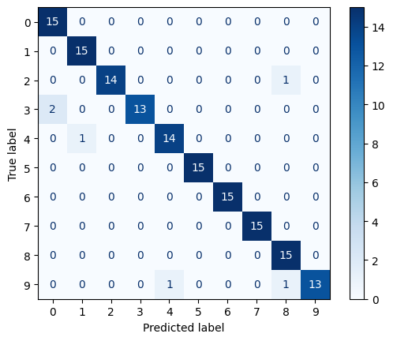

## 3D Digit Classifier
In this project the goal was to design and train a classifier model for classifying hand written digits from 3D motion sensor data. 
The dataset used for training and validation consists of 1000 strokes, 100 samples for each digit. Each stroke contains $N$ number of 3D data points, that
together form the hand written stroke as a function of time.

**Context:** Practical assignment for the course *Pattern Recognition and Machine Learning*, LUT University, autumn 2024. Team: Eetu Knutars, Eetu Peltola and Veeti Rajaniemi.

## Model
Our model is a multimodal neural network, where we use both individual numerical features of the data that are passed to a dense layer, and a 2D image projection that is passed to convolutional layer. 
The model achieved 96% accuracy on the course's held-out test data, which we did not have access to during development.



*Confusion matrix on our internal test split (15 strokes per digit), from the run saved in `classifier.ipynb`.*

## Requirements
Install the required packages with:

```
pip install -r requirements.txt
```

For GPU support, install PyTorch with CUDA first, e.g.:

```
pip install torch torchvision torchaudio --index-url https://download.pytorch.org/whl/cu118
```

## How to run
`digit_classify` takes an Nx3 NumPy array (one stroke of 3D points) and returns the predicted digit (0–9). Run from the repository root, since the trained weights are loaded from `best_model.pth`:

```python
import pandas as pd
from digit_classify import digit_classify

data = pd.read_csv('stroke.csv').to_numpy()  # Nx3 array of 3D points
print(digit_classify(data))
```

The training dataset is not included in this repository.

## Files
- `digit_classify.py` – the `digit_classify` function
- `classifier.py` – preprocessing, feature extraction, image creation, model and training code
- `classifier.ipynb` – the same pipeline as a notebook, with training and test output
- `best_model.pth` – trained model weights

## License
MIT, see [LICENSE](LICENSE).
